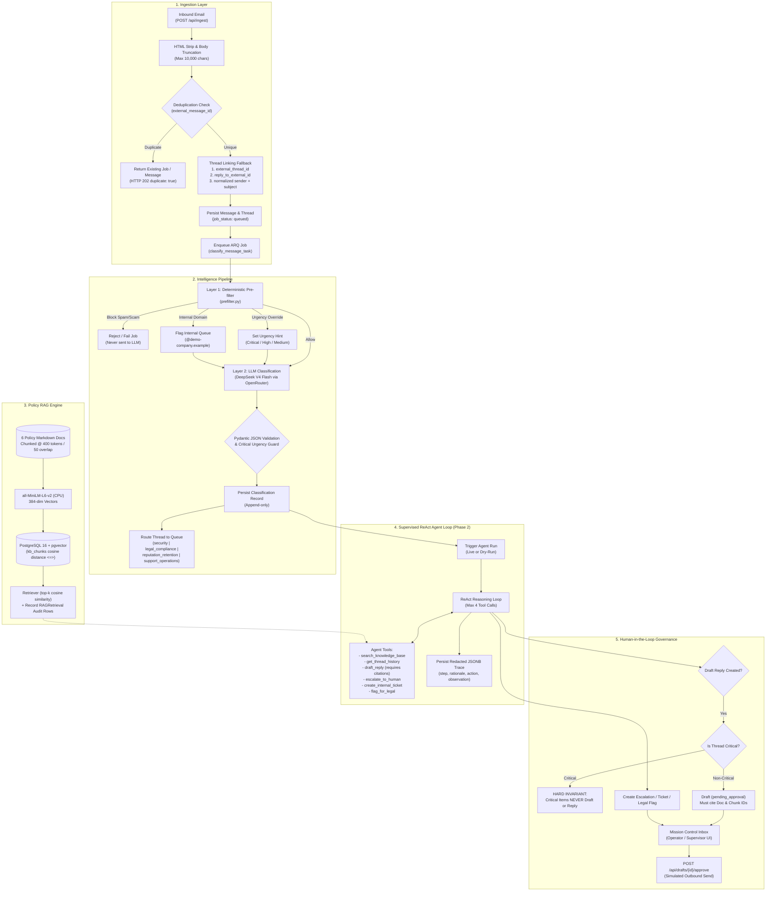
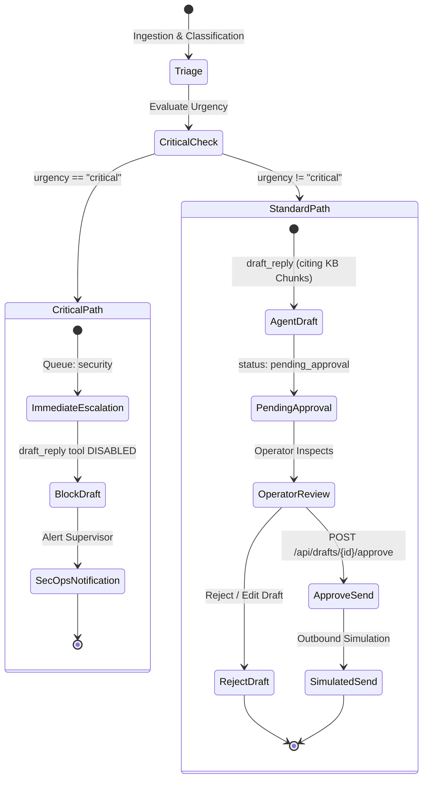
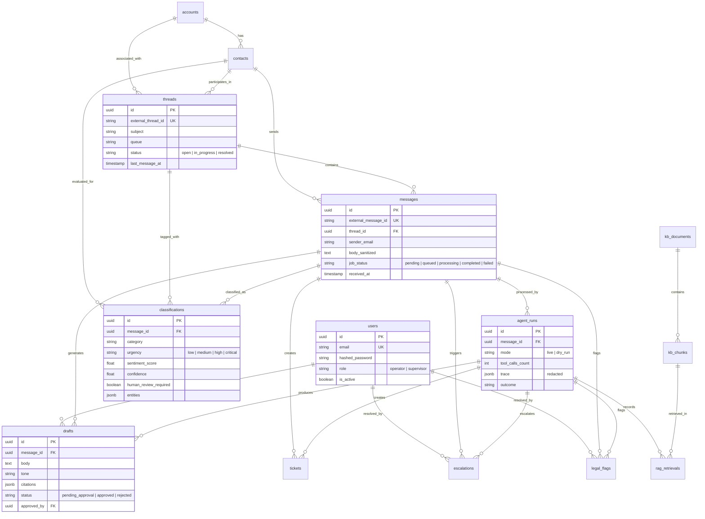

# AURA — Project Flow & System Architecture

> **AURA** (Agentic CRM Intelligence Platform) is a locally deployed, supervised email triage system for B2B SaaS inboxes (Nexus Software Inc.).
> This document details the end-to-end data pipeline, decision rules, RAG retrieval mechanism, ReAct agent loop, and human-in-the-loop governance invariants.

---

## 1. High-Level System Architecture



---

## 2. Step-by-Step Data Flow

### Step 1: Ingestion & Thread Linking (`app/api/ingest.py`)
1. **Endpoint**: `POST /api/ingest` accepts `{ external_message_id, external_thread_id?, reply_to_external_id?, sender_email, subject, body, received_at }`.
2. **Sanitization**:
   - `BeautifulSoup` strips HTML tags, raw scripts, and styles. Blank bodies return `HTTP 422 Unprocessable Entity`.
   - Large bodies (>10,000 characters) are sliced into the first 8,000 + last 2,000 characters to protect LLM context windows while preserving headers and sign-offs.
3. **Deduplication**:
   - Query `messages.external_message_id`. If matched, return the existing `message_id`, `thread_id`, and `job_id` with `duplicate: true`. No duplicate record or background job is created.
4. **Three-Tier Thread Linking**:
   - **Tier 1 (Exact External Thread ID)**: Match `threads.external_thread_id`.
   - **Tier 2 (Reply Reference)**: Look up `reply_to_external_id` in `messages.external_message_id` and attach to that parent message's thread.
   - **Tier 3 (Fuzzy Subject + Sender)**: Iteratively strip `Re:`, `Fwd:`, `Fw:` prefixes; match normalized subject and sender against the most recent open thread.
   - **Fallback**: Create a brand-new `Thread` record assigned to `support_operations`.
5. **Job Enqueue**:
   - Persists message with `job_status="queued"`.
   - Dispatches `classify_message_task` to the Redis ARQ queue.

---

### Step 2: Layer 1 Deterministic Pre-Filter (`app/intelligence/prefilter.py`)
Synchronous, deterministic rules evaluated before any external API call:

| Rule Branch | Criteria / Keywords | Action & Urgency Override | Target Queue / Behavior |
|---|---|---|---|
| **Rule 1: Spam / Scam** | `crypto giveaway`, `guaranteed profit`, `wire transfer`, `work from home`, `click here to claim`, `you've been selected` | `action="block"` | Message fails immediately. Never sent to LLM. |
| **Rule 2: Internal Domain** | Sender domain ends with `@demo-company.example` | `action="internal"` | Route to internal triage queue. |
| **Rule 3: Critical Security** | `ransomware`, `data breach`, `leaked credentials`, `unauthorized access`, `extortion`, `dark web` | `action="allow"`, `urgency_override="critical"` | Pre-pends urgency instruction; forces final urgency to `critical`. |
| **Rule 4: High Compliance/PR** | `dsar`, `gdpr`, `cease-and-desist`, `lawsuit`, `legal action`, `public review threat`, `press inquiry`, `investor inquiry` | `action="allow"`, `urgency_override="high"` | Routes to legal or reputation queues. |
| **Rule 5: Medium Operational** | `refund`, `billing dispute`, `service outage`, `misinformation`, `cancellation request` | `action="allow"`, `urgency_override="medium"` | Operational escalation threshold. |
| **Default** | No keyword matches | `action="allow"`, `urgency_override=None` | Pure LLM classification. |

---

### Step 3: Layer 2 LLM Classification (`app/intelligence/classifier.py`)
1. **Model Adapter**: DeepSeek V4 Flash 0731 via OpenRouter (OpenAI-compatible `/chat/completions`).
2. **Context Window**: Includes sanitized body, subject, and recent thread history (last 5 messages) plus any pre-filter system hints.
3. **Structured Output**: Strictly parsed into Pydantic model:
   - `category`: `security` | `legal_compliance` | `reputation` | `billing_refund` | `product_support` | `sales_pricing` | `general_inquiry`
   - `urgency`: `low` | `medium` | `high` | `critical`
   - `sentiment_score`: Continuous `[-1.0, 1.0]`
   - `confidence`: Continuous `[0.0, 1.0]`
   - `entities`: `{ people, organizations, topics, dates }`
   - `rationale` & `proposed_action`
4. **Safety Invariants**:
   - If pre-filter flagged `critical`, the output urgency is locked to `critical` (model downgrade is strictly prohibited).
   - If `confidence < 0.70`, `human_review_required` is automatically set to `true`.
5. **Persistence**:
   - Inserted as an **append-only** record into `classifications` (never updated, preserving full audit history).
   - Message updated to `job_status="completed"`.

---

### Step 4: RAG Policy Retrieval (`app/rag/embedder.py` & `retriever.py`)
1. **Knowledge Base Documents**:
   - 6 versioned Markdown policies in `backend/kb_documents/`:
     1. `api_limits_and_deprecations.md`
     2. `escalation_ownership_matrix.md`
     3. `gdpr_hipaa_soc2_data_residency.md`
     4. `pricing_tiers_and_discounts.md`
     5. `refunds_and_retention_offers.md`
     6. `sla_and_credits.md`
2. **Chunking & Embeddings**:
   - Chunked at 400 tokens with 50-token overlap.
   - Embedded locally using `all-MiniLM-L6-v2` (384-dimensional dense vectors, CPU-optimized).
3. **Search & Audit**:
   - Cosine distance search using pgvector's `<=>` operator:
     $$\text{score} = 1.0 - (\text{embedding} \iff \text{query\_vector})$$
   - Returns top $k$ chunks (default: 3).
   - Every search logs immutable `rag_retrievals` audit rows linking `agent_run_id`, `chunk_id`, `rank`, and `score`.

---

### Step 5: Layer 3 Sentiment & Risk Analytics
- Computed on-demand via composite index `(contact_id, created_at)` on `classifications`.
- **At-Risk Trigger**: If a contact has $\ge 3$ consecutive messages with `sentiment_score < -0.35`, the contact operational status transitions to `at_risk`.
- No separate rollup table is used; dynamic queries maintain real-time accuracy without sync anomalies.

---

### Step 6: Supervised ReAct Agent Loop (Phase 2)
1. **Loop Structure**: Custom Thought $\to$ Action $\to$ Observation loop capped at a hard maximum of **4 tool executions**.
2. **Auditable Traces**:
   - Private model chain-of-thought is discarded.
   - A sanitized, redacted JSONB trace is persisted to `agent_runs.trace`:
     ```json
     [
       {"step": 1, "rationale": "Checking customer thread history to understand invoice discrepancy", "action": "get_thread_history", "observation": "..."},
       {"step": 2, "rationale": "Searching refund policy for Enterprise tier customers", "action": "search_knowledge_base", "observation": "..."}
     ]
     ```
3. **Dry-Run Mode (`mode="dry_run"`)**:
   - Runs the full ReAct loop and plans all proposed actions.
   - Mutates **zero** production state: creates no ticket, escalation, legal flag, draft, or outbound send.
   - Persists only the `AgentRun` record marked with `outcome="dry_run"`.

---

### Step 7: Tool Execution Matrix

| Tool Name | Input Parameters | Output Payload | Status |
|---|---|---|---|
| `search_knowledge_base` | `query: str`, `max_results: int (1..3)` | `{ chunks: [{ chunk_id, document_id, title, excerpt, score }] }` | **MVP Active** |
| `get_thread_history` | `sender_email: str`, `limit: int (1..50)` | `{ threads: [{ thread_id, messages: [...] }] }` | **MVP Active** |
| `draft_reply` | `message_id: UUID`, `tone: str`, `policy_refs: [chunk_id]` | `{ draft_id, body, citations: [...], requires_approval: true }` | **MVP Active** |
| `escalate_to_human` | `message_id: UUID`, `reason: str`, `priority: str`, `queue: str` | `{ escalation_id, queue, priority, status: "open", brief }` | **MVP Active** |
| `create_internal_ticket` | `source_message_id: UUID`, `title: str`, `body: str`, `assignee_queue: str` | `{ ticket_id, assignee_queue, status: "open" }` | **MVP Active** |
| `flag_for_legal` | `message_id: UUID`, `issue_type: str`, `summary: str` | `{ legal_flag_id, issue_type, status: "open", queue: "legal_compliance" }` | **MVP Active** |
| `get_contact_profile` | `email: str` | `{ ok: false, error: "tool_not_enabled" }` | Contract Stub |
| `check_account_status` | `email: str` | `{ ok: false, error: "tool_not_enabled" }` | Contract Stub |

---

### Step 8: Human-in-the-Loop Governance & Safety Invariants



> [!CAUTION]
> **The Critical Invariant Rule**: If an email is classified as `critical` (ransomware, extortion, data leak, unauthorized access):
> 1. The agent loop is strictly forbidden from executing `draft_reply`.
> 2. `POST /api/drafts/{id}/approve` contains a hard backend check: any attempt to approve a reply tied to a Critical message raises `HTTP 400 Bad Request`.
> 3. No outbound email can ever be simulated or sent.

---

## 3. Database Entity Relationship Diagram

The PostgreSQL database encompasses 15 core entities:



---

## 4. Acceptance Scenarios Matrix

| Scenario | Input Case | Expected Intelligence | Tool Invocations | Expected Artifacts & Governance |
|---|---|---|---|---|
| **01: DSAR Compliance** | Customer demands erasure under GDPR Article 17 | `category: legal_compliance`<br>`urgency: high` | 1. `search_knowledge_base`<br>2. `flag_for_legal`<br>3. `create_internal_ticket`<br>4. `draft_reply` | - Legal Flag (`dsar`)<br>- Compliance Ticket<br>- Holding Ack Draft citing GDPR doc<br>- Approval required |
| **02: Ransomware Incident** | Attacker claims server encryption, demands BTC | `category: security`<br>`urgency: critical` (L1 Pre-filter lock) | 1. `escalate_to_human` | - Critical Escalation to `security`<br>- **NO draft created**<br>- **NO reply approved/sent** |
| **03: Misinformation / Outage** | Customer complains about conflicting outage SLA | `category: billing_refund`<br>`urgency: medium` | 1. `search_knowledge_base`<br>2. `create_internal_ticket`<br>3. `draft_reply` | - Ticket to Ops<br>- Empathetic Draft with SLA policy citations<br>- Operator approval flow |
| **04: Reputation Crisis** | Customer threatens negative G2 review & viral post | `category: reputation`<br>`urgency: high` | 1. `escalate_to_human`<br>2. `search_knowledge_base`<br>3. `draft_reply` | - Retention Escalation<br>- Web enrichment trigger<br>- Retention offer draft |
| **05: Conflicting Signals** | Thread disputes pricing tier previously offered | `category: sales_pricing`<br>`urgency: medium` | 1. `get_thread_history`<br>2. `search_knowledge_base`<br>3. `draft_reply` | - Full thread history inspected<br>- Correct legacy pricing honored<br>- Grounded draft citing pricing policy |

---

## 5. Security & Isolation Invariants

1. **Synthetic Data Only**: All processing is strictly confined to fictional demo data. Regex guards reject social security numbers or credit card patterns prior to any LLM API call.
2. **Deterministic Precedence**: Critical security threats always take precedence over billing or sales inquiries, preventing LLM prompt injection or downgrade attacks from obscuring security events.
3. **Immutable Audit Trails**: Classifications, RAG retrievals, agent traces, and audit logs are append-only.
4. **Local Infrastructure**: Embeddings (`all-MiniLM-L6-v2`) and pgvector store operate entirely on local CPU and Docker containers; zero persistent customer data leaves the host environment.
